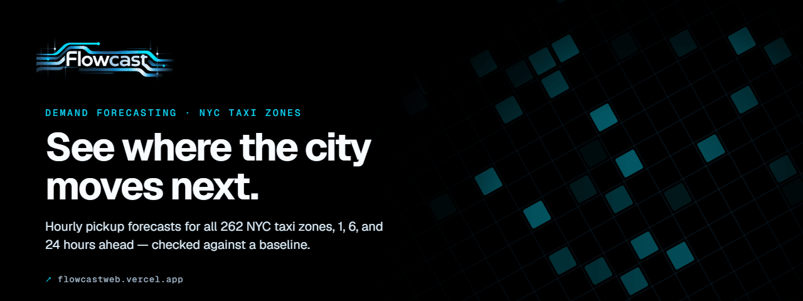
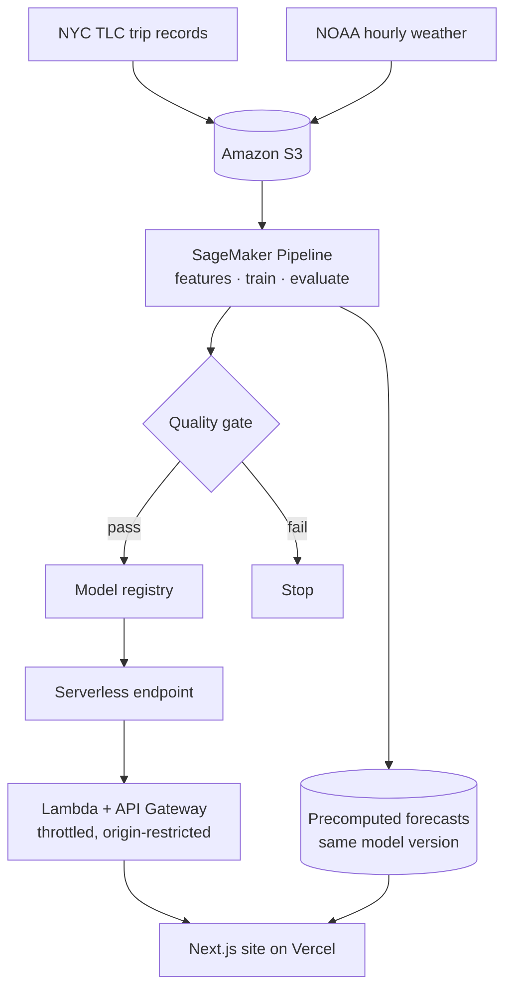

  

<h1 align="center">Flowcast</h1>

  <strong>A machine-learning platform that forecasts hourly taxi demand for every New York City taxi zone, 1, 6, and 24 hours ahead.</strong> 
  <a href="https://flowcastweb.vercel.app"><strong>Open Flowcast ↗</strong></a> · <a href="https://flowcastweb.vercel.app/model">Model card</a> · <a href="https://www.higginsd.com/work/flowcast">Case study</a> · <a href="https://davishiggins.com">Davis Higgins</a>

Live · Forecasts from published TLC data, not present-day demand · Built by Davis Higgins

---

## See it in motion

  

Real capture of flowcastweb.vercel.app/forecast in historical backtest mode. <a href="assets/demo.png">Static frame</a>

## What it does

- **A citywide forecast map.** Choose a forecast hour and a 1, 6, or 24-hour horizon. All 262 taxi zones are colored by expected pickups, and each zone opens to its prediction interval, the same hour last week, and the drivers behind the forecast.
- **Backtests you can check.** Historical mode replays held-out hours and puts predicted, actual, and baseline demand side by side, so a forecast is never shown without something to compare it to.
- **The model's work, in public.** A performance dashboard breaks error down by horizon, borough, time of day, and zone. A model card and architecture pages cover the data, features, evaluation split, quality gate, and limits.

## Why I built it

New York publishes every yellow-taxi trip, but as monthly files of raw records. Turning that into a forward view of how many pickups each zone should expect takes a modeling pipeline, not a spreadsheet.

A forecast is only useful if it can be checked. I wanted honest evaluation against a simple baseline, stated uncertainty, and a clear line between what the model predicts and what actually happened. I also wanted every number on the site to trace back to the model run that produced it.

## What I built

Flowcast is my project from end to end: data engineering, modeling, AWS deployment, and the web product.

- Ingestion of NYC TLC trip records, NOAA hourly weather, and the official taxi-zone boundaries into Amazon S3
- Leakage-safe time-series features and a single XGBoost model trained across every zone and horizon
- A SageMaker Pipeline with evaluation, SHAP explanations, drift checks, and a quality gate in front of the model registry
- Serverless inference behind AWS Lambda and API Gateway
- The Next.js site: forecast map, backtest mode, performance dashboard, model card, and architecture pages

## How it works

### Engineering decisions

| Decision | Why |
|---|---|
| **Features only look backward** | Lags and rolling windows are shifted so they only see hours before the forecast origin. The zone universe comes from the official lookup, not from demand, and encodings are fit on training data only. The pipeline also checks for leakage before a model can pass. |
| **A quality gate in front of the registry** | A model is registered only if it beats the same-hour-last-week baseline by a set margin, stays under an error ceiling, and returns finite, non-negative predictions. A failing run stops instead of quietly shipping. |
| **Same model, with or without the endpoint** | The site ships precomputed forecasts from the approved model version. Live endpoint results replace them only when the endpoint reports that same version, so the product keeps working if the endpoint is offline. The browser never calls SageMaker directly. |

One global model scores all 262 zones in a single batched request. Prediction intervals are calibrated on validation data only, never on the test period they're reported against.

## Screens

<table>
  <tr>
    <td width="62%"></td>
    <td rowspan="2" width="38%" align="center"></td>
  </tr>
  <tr>
    <td></td>
  </tr>
</table>

Forecast map with zone detail · Held-out evaluation against the baseline · Homepage on mobile

## Technology

| Layer | Technology | Responsibility |
|---|---|---|
| Data | NYC TLC trip records, NOAA hourly weather, TLC taxi-zone shapefile, Amazon S3 | Raw and processed data lake |
| Modeling | Python, pandas, XGBoost, SHAP | Features, training, evaluation, explanations |
| MLOps | Amazon SageMaker Pipelines and Model Registry | Repeatable training, quality gate, approved versions |
| Serving | SageMaker serverless endpoint, AWS Lambda, API Gateway | Batched citywide scoring behind a throttled API |
| Web | Next.js, TypeScript, Tailwind CSS, MapLibre GL, GSAP, Lenis | Forecast map, dashboard, model card |
| Hosting | Vercel | Static export of the site |

## Evaluation and limits

<strong>How the model was evaluated</strong>

 

- **Data.** 31 months of yellow-taxi trips (January 2024 – July 2026, about 116 million trips) joined with hourly NOAA weather from Central Park.
- **Split.** Chronological: train through December 2025, validation January – February 2026, held-out test March – July 2026.
- **Baseline.** The same zone and hour one week earlier (168-hour seasonal naive).
- **Result on the test period.** Weighted absolute percentage error (WAPE) of 0.186 against 0.247 for the baseline. That's about 25% lower error, and the model is ahead at every horizon (1h 0.179, 6h 0.191, 24h 0.189) and in every borough.
- **Uncertainty.** The 80% and 95% intervals covered 83% and 96% of test outcomes.

- **Not live demand.** Forecast mode predicts the hours after the latest published TLC data, which runs about two months behind. The site states the data cutoff next to every forecast.
- **Sparse zones are hard.** Outer-borough yellow-taxi demand is thin, so relative error there is much higher than in Manhattan. The dashboard shows this instead of averaging it away.
- **Zones, not GPS.** TLC records identify taxi zones rather than exact locations, so the map draws official zone boundaries.

## About this repository

This is a documentation-only showcase. Flowcast's pipeline code, infrastructure, model artifacts, and configuration are private and aren't included here.

**[Open Flowcast ↗](https://flowcastweb.vercel.app)** · Built by [Davis Higgins](https://davishiggins.com) · [More of my work](https://github.com/DavisHiggins)

© 2026 Davis Higgins. Text and images in this repository are shared for portfolio viewing. Trip data: NYC Taxi & Limousine Commission. Weather: NOAA. Map tiles © CARTO, © OpenStreetMap contributors. Not affiliated with the NYC TLC.
