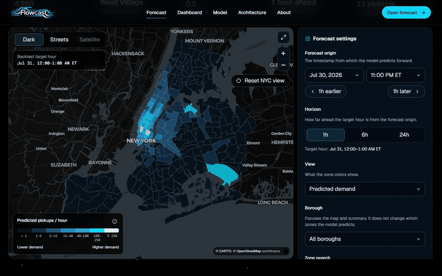
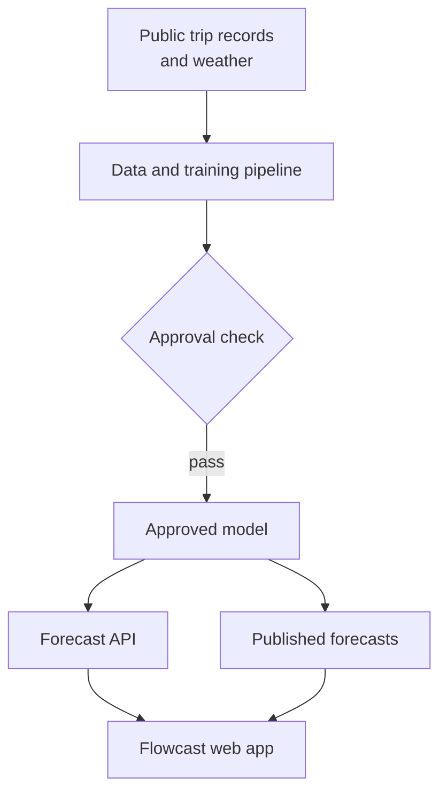
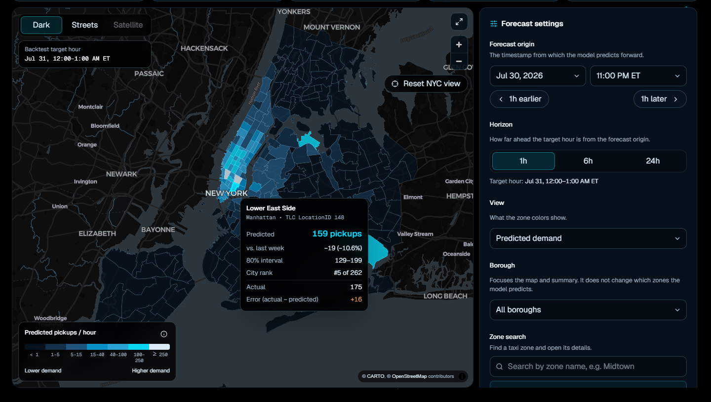
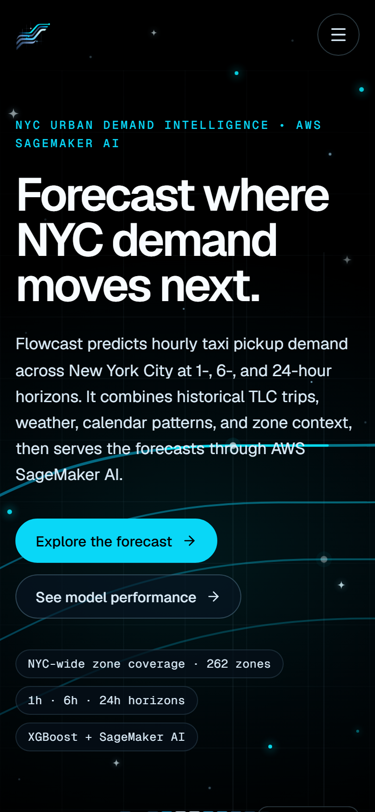
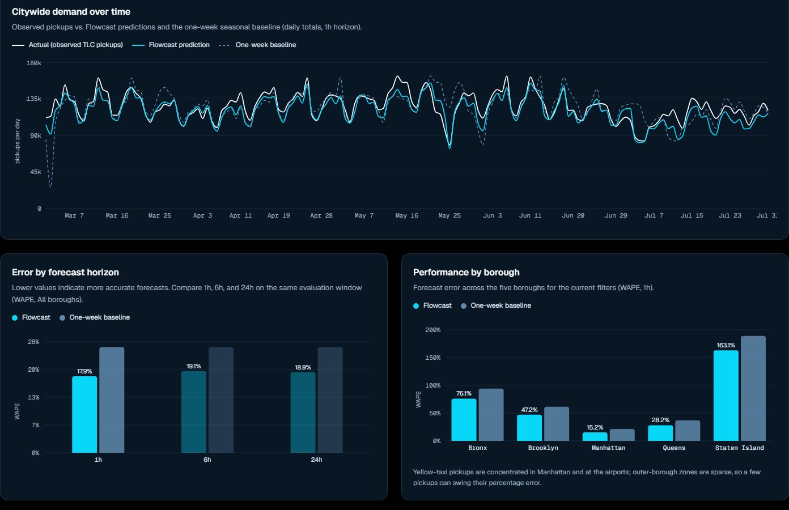

  

<h1 align="center">Flowcast</h1>

<strong>A machine-learning platform that forecasts hourly taxi demand for every New York City taxi zone, 1, 6, and 24 hours ahead.</strong>

  &nbsp;
  &nbsp;
  

Live · Forecasts built from NYC's published trip records · Designed and built by Davis Higgins

---

## See it in motion

  

Real capture of flowcastweb.vercel.app/forecast. <a href="assets/demo.png">Static frame</a>

## What it does

- **A citywide forecast map.** Choose a forecast hour and a 1, 6, or 24-hour horizon. All 262 taxi zones are colored by expected pickups, and each zone opens to its prediction range, the same hour last week, and what's driving the forecast.
- **Backtests you can check.** Historical mode replays past hours and puts predicted, actual, and baseline demand side by side, so a forecast is never shown without something to compare it to.
- **Performance in the open.** A dashboard breaks accuracy down by horizon, borough, time of day, and zone.

## Why I built it

New York publishes every yellow-taxi trip, but as monthly files of raw records. Turning that into a forward view of how many pickups each zone should expect takes a real modeling system, not a spreadsheet.

A forecast is only useful if it can be checked, so Flowcast is built around honest comparison: every prediction sits next to a baseline and the actual outcome, and every number on the site traces back to the model version that produced it.

## What I built

Flowcast is mine from end to end: data engineering, modeling, cloud deployment, and the web product.

- The data pipeline that turns raw trip records and weather into model-ready features
- A forecasting model that covers every zone and horizon, and beats a same-hour-last-week baseline by about 25% on held-out months
- Automated training, evaluation, and an approval step before any model reaches production
- Cloud inference behind a protected API
- The web product: forecast map, backtest mode, performance dashboard, and supporting pages

<strong>How it's put together</strong>

 

| Decision | Why |
|---|---|
| **No peeking at the future** | Training and evaluation are strictly chronological, so every reported result is earned on hours the model never saw. |
| **A model has to earn its release** | New models are compared against a simple baseline and checked for sane output before they're approved. A failing run stops instead of quietly shipping. |
| **The site works even if the API sleeps** | The web app ships forecasts from the approved model version and only swaps in live results from that same version, so the product never goes dark. |

## Screens

<table>
  <tr>
    <td width="62%"></td>
    <td rowspan="2" width="38%" align="center"></td>
  </tr>
  <tr>
    <td></td>
  </tr>
</table>

Forecast map with zone detail · Evaluation against the baseline · Homepage on mobile

## Technology

| Layer | Technology |
|---|---|
| Data and modeling | Python, pandas |
| Cloud | AWS |
| Web | Next.js, TypeScript, Tailwind CSS, MapLibre GL, GSAP |
| Hosting | Vercel |

---

  &nbsp;
  

© 2026 Davis Higgins. All rights reserved. Trip data: NYC Taxi &amp; Limousine Commission. Weather: NOAA. Map tiles © CARTO, © OpenStreetMap contributors.

